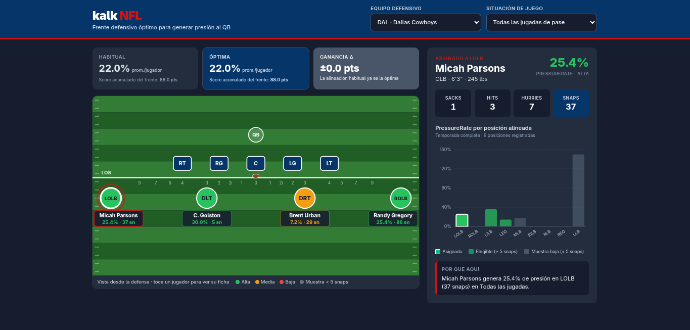

# kalk NFL — Optimizador Táctico del Frente Defensivo

**kalk NFL** es una aplicación web para Coordinadores Defensivos (*Coaches*) que calcula la asignación óptima uno-a-uno del frente de *Pass Rush* usando datos reales del NFL Big Data Bowl (`pffScoutingData`, `plays`, `players`).

## Hallazgo principal (Football Insight)
Al evaluar el rendimiento ponderado de cada jugador según su hueco de alineación (`pff_positionLinedUp`) con un filtro de elegibilidad de mínimo 5 snaps, reacomodar el frente defensivo supera consistentemente a la alineación habitual por posición nominal. Por ejemplo, en **Los Angeles Chargers** (todas las jugadas de pase), la asignación óptima eleva el score acumulado del frente de **44.9 pts a 48.2 pts (+7.4% vs. habitual)**, y en situaciones críticas como **Dallas Cowboys en 3er down y largo**, el reacomodo táctico incrementa la presión proyectada en **+31.41 puntos porcentuales**. La cancha interactiva y la gráfica comparativa por posición permiten al coach validar en segundos el *porqué* de cada movimiento y su tamaño de muestra.

## Declaración
Este proyecto fue desarrollado íntegramente durante el evento **NFL Big Data Bowl · UNAM 2026** únicamente por los integrantes del equipo.

